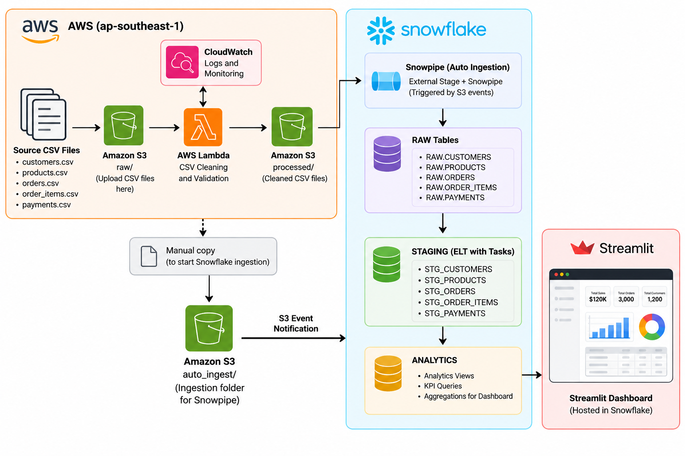
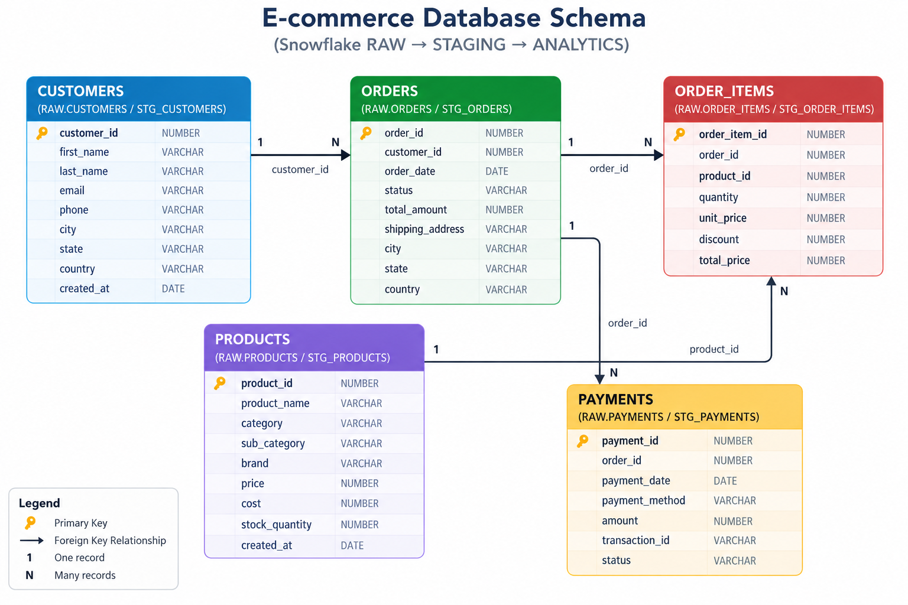
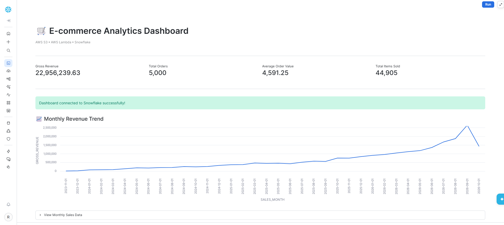
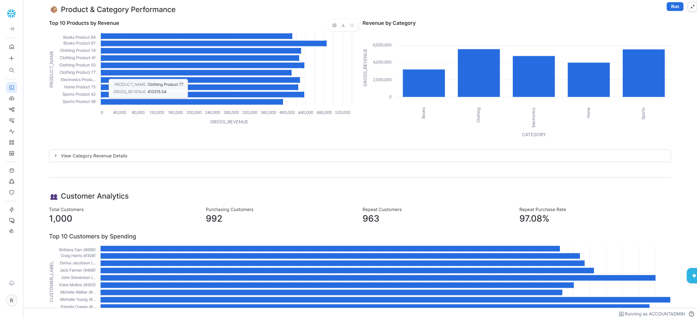
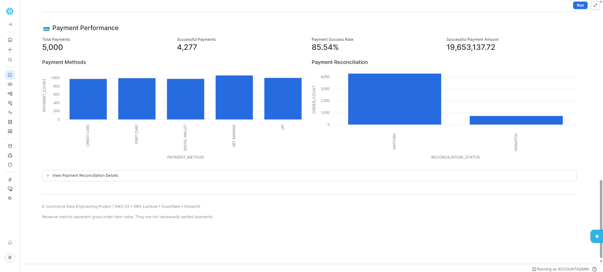

# AWS + Snowflake E-Commerce Data Engineering Pipeline

An end-to-end e-commerce data engineering project using AWS S3, AWS Lambda, Snowflake Snowpipe, Streams, Tasks, SQL, and Streamlit.

The project demonstrates cloud-based CSV preprocessing, automated data ingestion, incremental ELT transformations, analytical reporting, and dashboard visualization.

## Architecture



### Pipeline Workflow

1. Source CSV files are uploaded to Amazon S3 (`raw/`).
2. AWS Lambda processes and validates the files, writing results to `processed/`.
3. Processed files are copied to the S3 `auto_ingest/` directory.
4. S3 event notifications trigger Snowpipe ingestion into Snowflake RAW tables.
5. Snowflake Streams capture newly ingested records.
6. Scheduled Snowflake Tasks execute incremental MERGE transformations into STAGING tables.
7. SQL analytics views calculate business metrics.
8. A Streamlit dashboard hosted in Snowflake visualizes the results.

**Note:** The transfer from `processed/` to `auto_ingest/` is currently a manual step. Ingestion and transformation are automated after this handoff.

## Technology Stack

| Component | Technology |
|---|---|
| Cloud storage | Amazon S3 |
| Serverless processing | AWS Lambda, Python |
| Monitoring | Amazon CloudWatch |
| Data warehouse | Snowflake |
| Automated ingestion | Snowpipe, S3 event notifications |
| Incremental ELT | Snowflake Streams and Tasks |
| Data transformations | SQL, MERGE |
| Analytics | Snowflake SQL Views |
| Dashboard | Streamlit in Snowflake |
| Version control | Git, GitHub |

## Data Model



The project contains five primary datasets:

- Customers
- Products
- Orders
- Order Items
- Payments

These datasets are transformed into relational STAGING tables and used to create analytical views.

## Repository Structure

```text
aws-snowflake-ecommerce-pipeline/
├── aws/
│   └── iam/
├── dashboard/
│   ├── streamlit_app.py
│   └── screenshots/
├── data/
│   ├── raw/
│   └── processed/
├── docs/
│   ├── architecture.png
│   └── data_model.png
├── lambda/
│   └── lambda_function.py
├── scripts/
│   ├── generate_data.py
│   └── validate_data.py
├── snowflake/
│   ├── 01_create_database.sql
│   ├── ...
│   ├── 26_create_snowpipes.sql
│   ├── 27_create_streams.sql
│   └── 28_create_transform_tasks.sql
├── requirements.txt
└── README.md
```

## Data Ingestion

Snowpipe automatically ingests CSV files from the following S3 prefixes:

- `auto_ingest/customers/`
- `auto_ingest/products/`
- `auto_ingest/orders/`
- `auto_ingest/order_items/`
- `auto_ingest/payments/`

Five Snowpipes load these datasets into their corresponding Snowflake RAW tables.

## Incremental ELT Processing

Five append-only Snowflake Streams track newly inserted RAW records.

Five scheduled Tasks run every 15 minutes, using conditional execution and SQL MERGE statements to update the STAGING tables.

The transformations support incremental processing without reloading the entire dataset.

Tasks can be suspended when the pipeline is not in use to conserve Snowflake credits.

## Analytics and Dashboard

The analytics layer provides reporting views for:

- Revenue and sales performance
- Daily and monthly sales trends
- Product and category performance
- Customer analytics
- Payment methods and payment reconciliation

The dashboard is built using Streamlit and hosted directly within Snowflake.

### Revenue Overview



### Product and Customer Analytics



### Payment Analytics



## Pipeline Testing and Validation

The pipeline was tested using synthetic e-commerce transactions.

| Test | Result |
|---|---|
| Automated S3-to-Snowflake ingestion | Passed |
| RAW-to-STAGING incremental transformation | Passed |
| Analytics and dashboard integration | Passed |
| Invalid numeric data detection | Passed |
| Recovery after a failed ingestion | Passed |
| Lambda throttling check | No throttling observed |

An end-to-end test confirmed that a new customer, product, order, order item, and payment could be ingested and transformed automatically after upload to the Snowpipe ingestion prefixes.

A malformed numeric identifier was detected during ingestion. A subsequent corrected file was successfully processed.

## Cost Monitoring

During testing:

- AWS estimated charges: USD 0.00 for October 2026 at the time of review.
- Snowflake warehouse metering: approximately 13.25 reported credits across the queried warehouse categories over 30 days.

These figures are historical observations, not guaranteed operating costs. Snowpipe serverless usage and other Snowflake charges may be additional.

## Project Screenshots

Screenshots of the S3 structure, Snowpipes, scheduled Tasks, and Streamlit dashboard are available in `dashboard/screenshots/`.

## Implementation Notes

- The current S3 preprocessing-to-ingestion handoff is manual.
- Snowpipe uses S3 event notifications for automatic ingestion.
- Streams and Tasks support incremental RAW-to-STAGING processing.
- The Streamlit dashboard runs within Snowflake.
- AWS IAM policies and Snowflake storage integrations require account-specific configuration.
- Snowflake Tasks are normally suspended outside active testing to conserve credits.

## Author

**Raihan Mohammed Rafeeq**

Computer Science & AI Graduate | Data Engineering | AWS | Snowflake

[Portfolio](https://raihanrafeeq.github.io/portfolio/) |
[GitHub](https://github.com/RaihanRafeeq)
